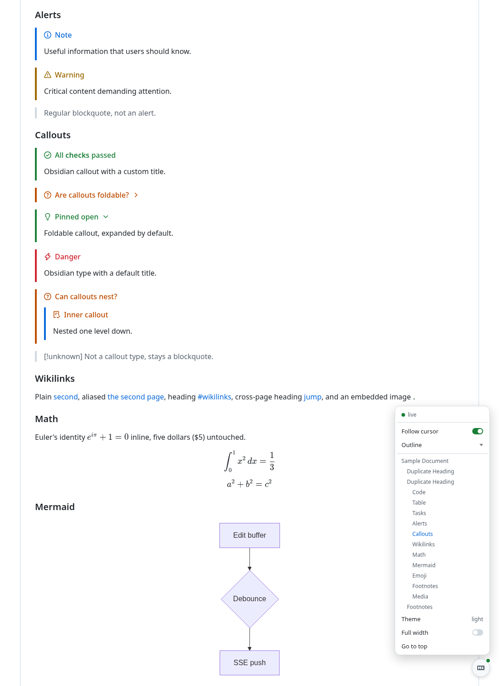
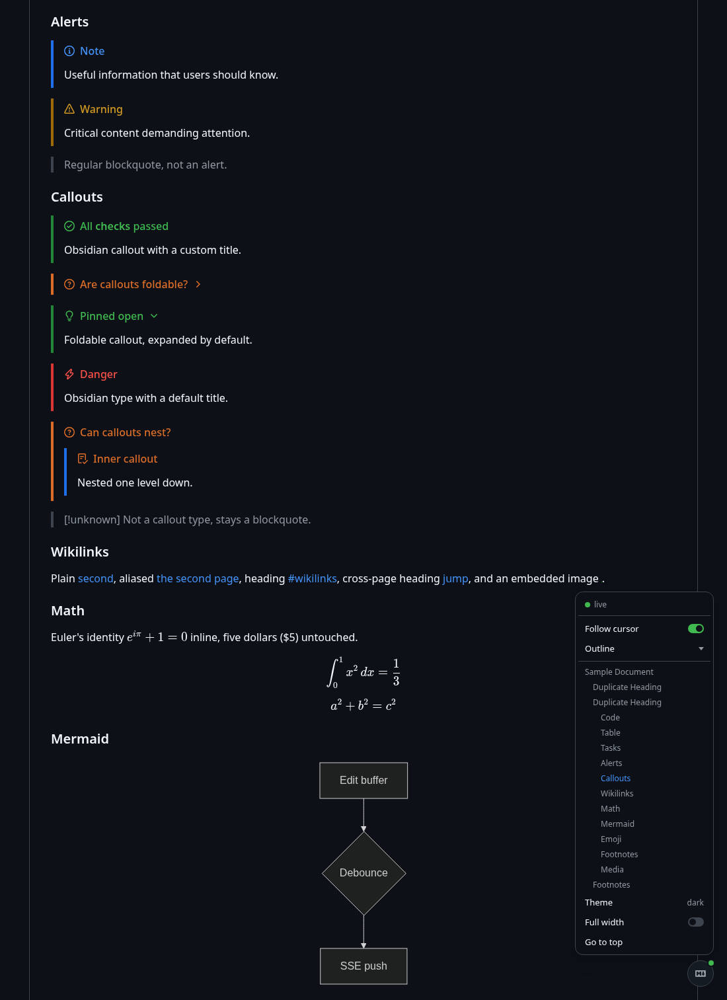

# mdpv.nvim

Markdown preview for Neovim that renders exactly like GitHub, in your
browser, with **zero external runtimes** — no Node, no Deno, no Python. A
pure-Lua HTTP + SSE server built on `vim.uv` streams your buffer to a page
styled with GitHub's actual CSS.

| Light | Dark |
| --- | --- |
|  |  |

## Features

**GitHub-exact rendering**

- The official
  [github-markdown-css](https://github.com/sindresorhus/github-markdown-css)
  plus GitHub's exact markup: alerts, task lists, footnotes, heading anchors,
  highlight.js code, emoji shortcodes, frontmatter tables, sanitized raw HTML.
- **Obsidian callouts** — the whole
  [callout vocabulary](https://obsidian.md/help/callouts) on top of GitHub's
  five alerts: 13 types with aliases, custom titles, foldable
  `> [!faq]- …` / `> [!tip]+ …`, and nesting.
- **Wikilinks** — `[[page]]`, `[[page|alias]]`, `[[page#heading]]`, and
  `![[image.png]]` embeds resolve Obsidian-style against the file's directory.
- **KaTeX math** (`$…$`, `$$…$$`, ` ```math `, custom macros) and **Mermaid
  diagrams** with hover pan/zoom controls — vendored, fetched only when a
  document uses them.

**Live editing**

- Edits stream as you type — `:s`, undo, and LSP formatting included — and
  land flicker-free: updates are DOM-diffed with morphdom, so images don't
  reload, open `<details>` stay open, and typeset math, diagrams, and
  highlighted code survive edits elsewhere untouched.
- **Scroll sync** — the preview follows your cursor, marks the block you're
  on, and parks the URL hash on the heading you're editing (a ready-made deep
  link); `scroll_sync = 'both'` lets page scrolls move the cursor back.
- **Clickable task lists** — tick a checkbox in the preview and the
  `- [ ]`/`- [x]` flips on that line in your buffer.
- **Live image reload** — regenerate a screenshot or diagram on disk and
  every open preview refreshes just that image.

**Reading**

- One floating button (drag it to any corner) opens the page menu: a
  scroll-spied **document outline**, follow toggle, theme (auto/light/dark),
  full width, go to top — all persisted per browser.
- A copy button on every code block; video and audio that actually seek
  (byte-range serving); instant first paint straight from the page shell.
- Relative links resolve like on GitHub — a linked `.md` renders as a page
  too (`?raw` for the source).

**Plumbing**

- Any number of previews at once on one shared, lazily-started server; each
  buffer gets an unguessable URL; previews auto-close with their buffer and
  the server auto-stops with the last preview.
- Localhost-only, token-gated routes, strict CSP, DOMPurify on raw HTML.

## Requirements

- Neovim **0.12+**.
- A browser. `vim.ui.open()` is used to launch it (`xdg-open`/`open`/
  `explorer.exe`).
- Nothing else. Frontend libraries are vendored in `assets/vendor/`.

## Install

**vim.pack (Neovim 0.12 built-in):**

```lua
vim.pack.add({ 'https://github.com/hitori-chan/mdpv.nvim' })
```

**lazy.nvim:**

```lua
{
  'hitori-chan/mdpv.nvim',
  cmd = 'Preview',
  opts = {}, -- optional; see configuration
}
```

## Usage

| Command | Action |
| --- | --- |
| `:Preview` / `:Preview open` | open (or re-open) a preview for the current buffer |
| `:Preview!` | force-preview a non-markdown buffer |
| `:Preview close` | close the current buffer's preview |
| `:Preview toggle` | open/close the current buffer's preview |
| `:Preview list` | list active previews and their URLs |
| `:Preview stop` | close all previews and stop the server |

(Neovim requires user commands to start with an uppercase letter, so a literal
`:preview` is not possible; `:Preview` is the closest the editor allows.)

Lua API: `require('mdpv').open(bufnr?, {force?})`, `.close(bufnr?)`,
`.toggle(bufnr?)`, `.stop()`, `.list()`, `.url(bufnr?)`. Full reference:
`:help mdpv`.

## Configuration

Calling `setup()` is optional — these are the defaults:

```lua
require('mdpv').setup({
  host = '127.0.0.1',      -- interface to bind; keep loopback unless you know why
  port = 0,                -- 0 = pick a free ephemeral port (no conflicts, ever)
  theme = 'auto',          -- 'auto' | 'light' | 'dark'
  debounce = 150,          -- ms of quiet time before pushing an edit
  filetypes = { 'markdown' }, -- eligible without :Preview! force
  auto_close = true,       -- close the preview when its buffer is unloaded
  auto_stop = true,        -- stop the server when the last preview closes
  open_browser = true,     -- false: only print the URL (headless/SSH — then
                           -- forward the port and open it yourself)
  math = true,             -- $…$ / $$…$$ / ```math via KaTeX (lazy-loaded);
                           -- or { macros = { ['\\RR'] = '\\mathbb{R}' } }
  mermaid = true,          -- ```mermaid diagrams (lazy-loaded)
  emoji = true,            -- :shortcode: expansion
  wikilinks = true,        -- [[page]] links + ![[image]] embeds, Obsidian style
  reload_images = true,    -- refresh images in open previews when they change on disk
  scroll_sync = true,      -- preview follows the cursor (toggleable in-page);
                           -- 'both': page scrolls also move the cursor
})
```

`:checkhealth mdpv` verifies the runtime and vendored assets.

## Non-goals / current limitations

- Math renders with KaTeX (GitHub uses MathJax); output is visually
  near-identical for everyday TeX but not glyph-for-glyph.
- Frontmatter nested deeper than one level of maps/lists is stripped rather
  than rendered as a table.
- Relative links are confined to the previewed file's own directory and its
  subtree; a link pointing *above* it (`../sibling.md`) is not served — the
  file route blocks `..` traversal.

## Development

Tests, formatting, vendoring, and the design rationale live in
[docs/DEVELOPMENT.md](docs/DEVELOPMENT.md) and
[docs/DESIGN.md](docs/DESIGN.md).

## License

MIT — see [LICENSE](LICENSE). Vendored frontend libraries keep their own
(permissive) licenses, pinned in `assets/vendor/VERSIONS.txt`.
