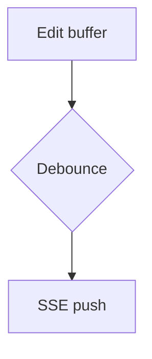

# Sample Document

Some **bold**, _italic_, `inline code`, ~~strikethrough~~, and a bare autolink
https://example.com plus an [inline link](https://example.com/page).

## Duplicate Heading

## Duplicate Heading

### Code

```lua
local function greet(name)
  return ('hello %s'):format(name)
end
```

```text
plain fenced block
```

    indented code block

### Table

| Feature   | Status | Notes          |
| --------- | :----: | -------------- |
| Tables    |   ✅   | GFM pipes      |
| Alignment |   ✅   | centered cell  |

### Tasks

- [x] shipped thing
- [ ] pending thing
- regular item

### Alerts

> [!NOTE]
> Useful information that users should know.

> [!WARNING]
> Critical content demanding attention.

> Regular blockquote, not an alert.

### Math

Euler's identity $e^{i\pi} + 1 = 0$ inline, five dollars ($5) untouched.

$$
\int_0^1 x^2 \, dx = \frac{1}{3}
$$

```math
a^2 + b^2 = c^2
```

### Mermaid



### Emoji

Ship it :rocket: :tada:

### Footnotes

Here is a claim.[^1]

[^1]: And here is the footnote text.

### Media


<details><summary>Raw HTML details</summary>

Hidden *markdown* content.

</details>

<script>document.body.innerHTML = 'XSS'</script>
